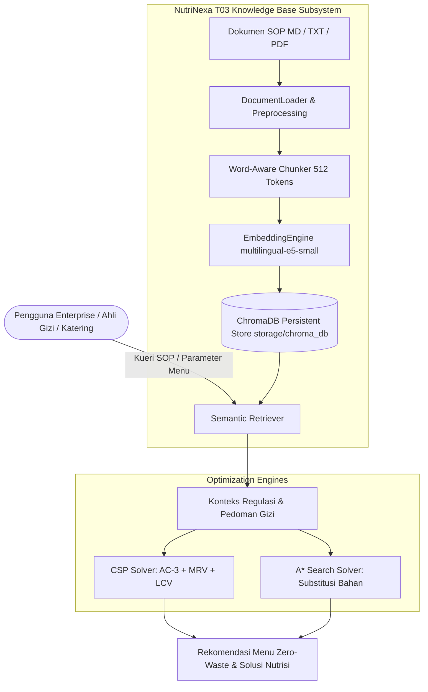

# NutriNexa (CERTAN-KEL-15)

NutriNexa (*Enterprise Food Waste & Recipe Optimizer*) adalah Sistem Informasi Cerdas Enterprise berbasis AI yang dirancang untuk meminimalkan limbah makanan (*zero-waste culinary*), mengoptimalkan perencanaan menu katering/institusi, dan menegakkan kepatuhan terhadap Standard Operating Procedure (SOP) gizi.

Sistem NutriNexa mengintegrasikan subsistem cerdas modular:
1. **Milestone T01 — Baseline A* Search Engine (`src/search_solver.py`):** Algoritma pencarian graf rute substitusi bahan pangan terhemat berdasarkan fungsi evaluasi biaya dan selisih nutrisi ($f(n) = g(n) + h(n)$).
2. **Milestone T02 — CSP Optimization Engine (`src/csp_solver.py`):** Mesin pemecah batasan berbasis *Constraint Satisfaction Problem* (AC-3 Arc Consistency, Backtracking Search, MRV Heuristic, dan LCV Prioritas Zero-Waste) untuk menyusun alokasi menu yang patuh 100% pada inventaris, kalori, dan restriksi alergen.
3. **Milestone T03 — Enterprise Knowledge Base Subsystem (`src/knowledge_base/`):** Subsistem pengetahuan modular berbasis pembersihan teks, word-aware chunking dengan kuota 512 token, dense embeddings asimetris (`intfloat/multilingual-e5-small`), penyimpanan vektor persisten ChromaDB, dan semantic retrieval dengan perankingan kosinus, penyaringan ambang batas, serta diversifikasi MMR.

---

## 👥 Tim Pengembang (Kelompok 15 — Institut Teknologi Del)
- **AI Architect & Model Lead:** Choqy Pananda Sirait (12S24012)
- **Data & Knowledge Engineer:** Yesika Nadia Saragih (12S24024)
- **Integration & Interface Engineer:** Josua Sianturi (12S24035)
- **QA, Evaluation & Ethics Lead:** Jaya Bestina Simbolon (12S24023)

---

## 📐 Arsitektur Sistem (System Architecture)



---

## 🛠 Struktur Direktori Proyek

```
CERTAN-KEL-15/
├── .venv/                         # Virtual environment otomatis dari Astral uv
├── data/                          # Data korpus dan evaluasi
│   ├── evaluation/                # Kumpulan kueri benchmark retrieval
│   │   └── benchmark_queries.json
│   ├── fixtures/                  # Fixture pengujian sintetis
│   │   └── pedoman_gizi_toba_synthetic.txt
│   └── knowledge_base/            # Korpus SOP resmi terverifikasi
│       ├── manifest.json          # Manifest metadata korpus resmi
│       ├── pedoman_standar_gizi_seimbang.md
│       └── sop_reduksi_limbah_pangan_dapur.md
├── docs/                          # Laporan teknis dan kontrak arsitektur
│   ├── engineering/
│   │   └── T03_TECHNICAL_CONTRACT.md
│   ├── Grup15-Tugas01.pdf
│   └── Grup15-Tugas02.pdf
├── reports/                       # Laporan hasil benchmark kuantitatif
│   └── retrieval_benchmark.json
├── scripts/                       # Skrip CLI automasi operasional
│   ├── benchmark_retrieval.py     # Skrip benchmark temu-balik (Hit@K, MRR, Latensi)
│   ├── ingest_corpus.py           # Skrip pipeline ingestion korpus ke ChromaDB
│   └── smoke_test_knowledge_base.py # Smoke test mandiri model riil
├── src/                           # Source code inti NutriNexa
│   ├── csp_solver.py              # CSP Solver (Milestone T02)
│   ├── search_solver.py           # A* Search Solver (Milestone T01)
│   └── knowledge_base/            # Subsistem Knowledge Base (Milestone T03)
│       ├── __init__.py
│       ├── chunker.py             # Word-aware chunking & token budget
│       ├── document_loader.py     # Loader PDF (pypdf), Markdown, Text
│       ├── embedding_engine.py    # intfloat/multilingual-e5-small CPU
│       ├── preprocessing.py       # Pembersihan teks & validasi dokumen
│       ├── retriever.py           # Semantic search, Cosine, MMR & filter
│       ├── schemas.py             # Dataclass kontrak skema ketat
│       └── vector_store.py        # Persistent ChromaDB wrapper
├── tests/                         # Test suite lengkap (72 pytest tests)
│   ├── test_chunker.py
│   ├── test_csp_solver.py
│   ├── test_document_loader.py
│   ├── test_embedding_engine.py
│   ├── test_evaluation_metrics.py
│   ├── test_knowledge_base_schemas.py
│   ├── test_preprocessing.py
│   ├── test_retriever.py
│   ├── test_search_solver.py
│   └── test_vector_store.py
├── pyproject.toml                 # Konfigurasi dependensi uv (CPU-first)
├── README.md                      # Dokumentasi utama proyek
└── uv.lock                        # Lockfile dependensi deterministik
```

---

## 🚀 Setup & Panduan Eksekusi

### 1. Sinkronisasi Environment (Astral uv)
Proyek menggunakan PyTorch versi CPU secara eksplisit untuk efisiensi RAM/VRAM:
```bash
uv sync
```

### 2. Menjalankan Seluruh Unit Test (72 Pengujian)
```bash
uv run pytest -v
```

### 3. Memeriksa Kualitas Kode (Ruff Linter)
```bash
uv run ruff check . --output-format concise
```

### 4. Menjalankan Smoke Test Knowledge Base (Model Riil)
Menguji inisialisasi model `intfloat/multilingual-e5-small`, embedding 384 dimensi, dan persistensi ChromaDB:
```bash
uv run python scripts/smoke_test_knowledge_base.py
```

### 5. Menjalankan Ingestion Korpus Dokumen
Memuat seluruh dokumen terverifikasi pada `data/knowledge_base/manifest.json` ke dalam ChromaDB:
```bash
uv run python scripts/ingest_corpus.py --chunk-size 150 --chunk-overlap 30 --replace
```

### 6. Menjalankan Benchmark Evaluasi Temu-Balik Semantik
Mengukur Hit@K, Recall, Presisi, MRR, Keputusan Tiga Arah OOD, dan distribusi latensi:
```bash
uv run python scripts/benchmark_retrieval.py
```

---

## 📊 Hasil Evaluasi Kuantitatif Benchmark (T03 Final)

Evaluasi kuantitatif diuji pada 16 dokumen korpus terverifikasi (51 chunks terindeks via Config A: 150 kata / overlap 30 kata) dan 35 kueri evaluasi held-out (23 in-domain, 12 out-of-distribution) menggunakan skrip [`scripts/benchmark_retrieval.py`](file:///d:/Github/nutrinexa-enterprise-ai-KEL15Certan/scripts/benchmark_retrieval.py):

| Metrik Evaluasi | Target / Budget | Hasil Pengujian Riil | Status |
| :--- | :--- | :--- | :--- |
| **Hit@1 (Macro)** | $\ge 80.0\%$ | **91.3%** | PASS (Optimal) |
| **Hit@3 (Macro)** | $\ge 90.0\%$ | **100.0%** | PASS (Optimal) |
| **Hit@5 (Macro)** | $\ge 95.0\%$ | **100.0%** | PASS (Optimal) |
| **Document Recall@1 (Macro)** | $\ge 70.0\%$ | **79.7%** | PASS |
| **Document Recall@1 (Micro)** | $\ge 70.0\%$ | **72.4%** (21/29 ground truth) | PASS |
| **Document Recall@5 (Macro)** | $\ge 90.0\%$ | **100.0%** ($\le 1.0$) | PASS (Optimal) |
| **Document Recall@5 (Micro)** | $\ge 90.0\%$ | **100.0%** (29/29 ground truth) | PASS (Optimal) |
| **Chunk Precision@5 (Macro)** | $\ge 40.0\%$ | **54.8%** | PASS |
| **Document Precision@5 (Macro)** | N/A | **25.2%** | PASS |
| **Mean Reciprocal Rank (MRR)** | $\ge 0.85$ | **0.9493** | PASS (Optimal) |
| **OOD Decision: True Rejection Rate (TRR)** | $\ge 80.0\%$ | **83.3%** (10/12 $s < 0.840$) | PASS |
| **OOD Decision: Abstention Rate** | N/A | **16.7%** (2/12 dalam $[0.840, 0.855]$) | PASS |
| **OOD Decision: False Acceptance Rate (FAR)** | $\le 5.0\%$ | **0.0%** (0/12 $s > 0.855$) | PASS (Optimal) |
| **In-Domain Decision: True Acceptance Rate** | $\ge 95.0\%$ | **100.0%** (23/23 $s > 0.855$) | PASS (Optimal) |
| **In-Domain Decision: False Rejection (FRR)** | $\le 5.0\%$ | **0.0%** (0/23 $s < 0.840$) | PASS (Optimal) |
| **Akurasi Definitif Keseluruhan** | $\ge 90.0\%$ | **94.3%** (33/35 keputusan tegas) | PASS |
| **Total Cold-Start Latency (Model Load)** | $< 25\text{ s}$ (CPU) | **17.52 s** (Model: 17.48s, Warmup: 37.6ms) | PASS |
| **Warm Mean Latency** | $< 50\text{ ms}$ (CPU) | **31.45 ms** | PASS |
| **Warm Median Latency (P50)** | $< 50\text{ ms}$ (CPU) | **30.29 ms** | PASS |
| **Warm P95 Latency** | $< 100\text{ ms}$ (CPU) | **38.59 ms** | PASS |

---

## 🔒 Lisensi & Integritas Akademik
Dikembangkan untuk mata kuliah Kecerdasan Buatan / Capstone Enterprise AI — Institut Teknologi Del.  
Hak Cipta © 2026 Kelompok 15. Dilindungi lisensi akademik IT Del.
